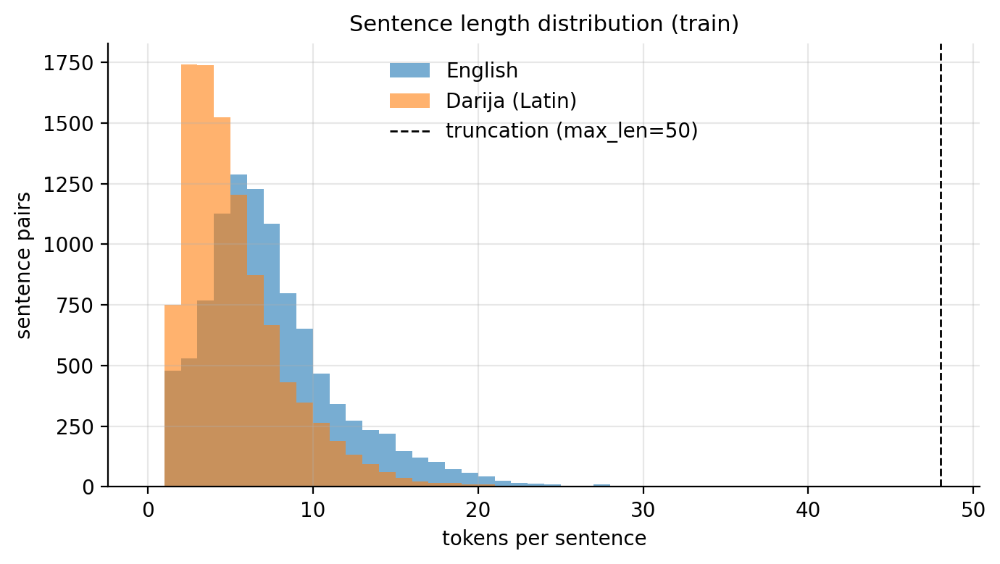
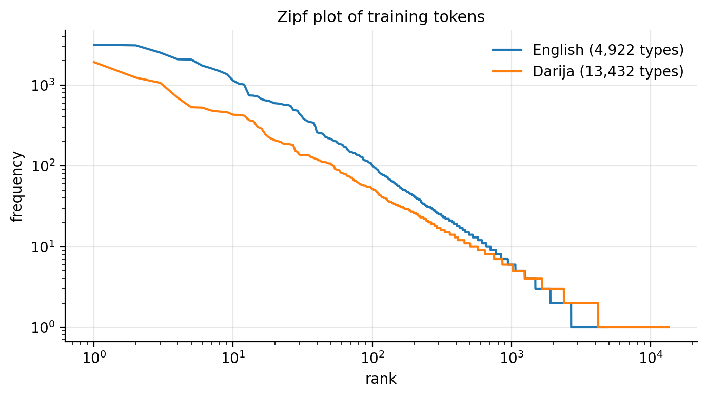
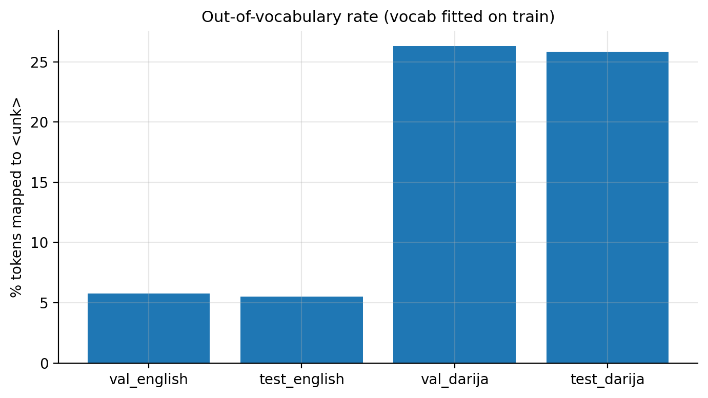
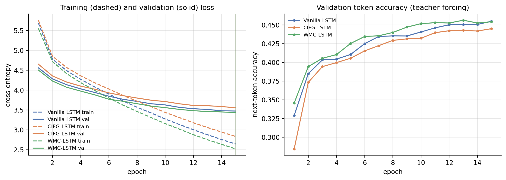
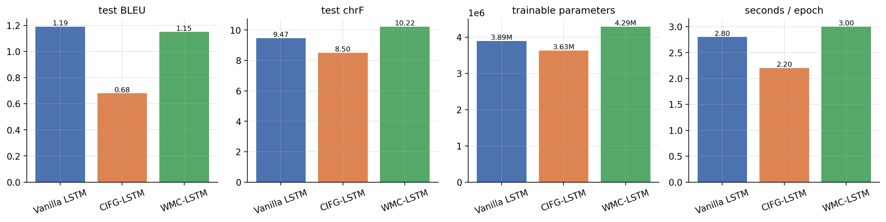
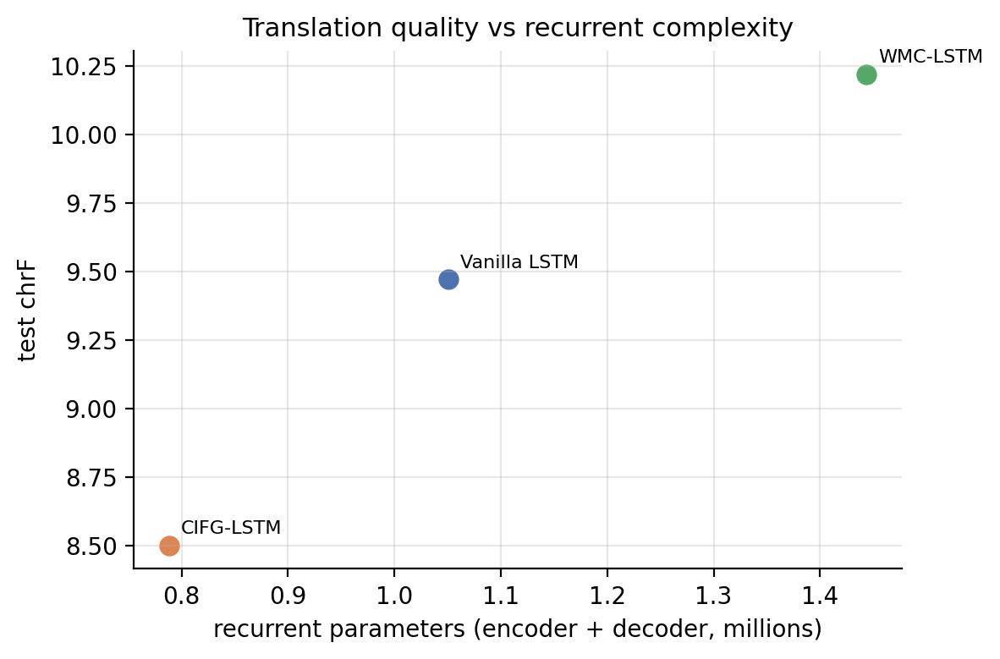
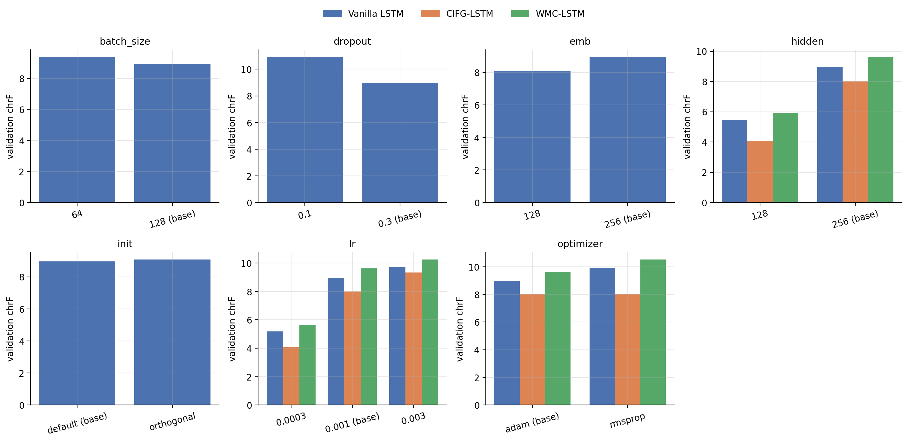

# 🇲🇦 English-to-Darija Neural Machine Translation

### A Comparative Study of Vanilla LSTM, CIFG-LSTM & Working Memory Connections

**Advanced Natural Language Processing | Academic Year 2026–2027**

A research-oriented NLP project investigating how different LSTM gating and memory mechanisms influence translation quality, parameter efficiency, and computational complexity in English-to-Moroccan Darija neural machine translation.

All recurrent cells are implemented from scratch using **PyTorch `nn.Linear`**, without using the built-in `nn.LSTM` module.

---

## 01. Project Overview

Moroccan Darija is a low-resource language characterized by lexical diversity, non-standardized spelling, and multiple writing conventions. These characteristics make automatic translation particularly challenging.

This project develops a sequence-to-sequence neural machine translation system and compares three recurrent architectures:

- **Vanilla LSTM:** A standard recurrent baseline.
- **CIFG-LSTM:** A simplified architecture with coupled input and forget gates.
- **WMC-LSTM:** An architecture incorporating additional working-memory connections.

### Research Question

> How do different LSTM gating and memory mechanisms affect translation quality, parameter efficiency, and computational performance in English-to-Moroccan Darija neural machine translation?

The goal is not simply to identify the highest-performing model, but to understand the trade-offs between architectural complexity, computational cost, and translation performance.

## 02. Research Objectives

- Implement three custom LSTM architectures using PyTorch.
- Develop an encoder-decoder neural translation system.
- Explore and preprocess a real English-Darija parallel corpus.
- Evaluate translation quality using BLEU and chrF.
- Compare trainable parameter counts and computational efficiency.
- Investigate the influence of hyperparameters.
- Analyze translation errors and model limitations.
- Identify potential directions for improving low-resource translation.

## 03. Dataset and Exploratory Data Analysis

**Dataset:** [Darija-English — Hugging Face](https://huggingface.co/datasets/imomayiz/darija-english)

| Property | Description |
|---|---|
| Configuration | `sentences` |
| Source Language | English |
| Target Language | Moroccan Darija |
| Writing System | Latin script |
| NLP Task | Neural Machine Translation |
| Development Framework | PyTorch |

The dataset is loaded through Hugging Face and is not redistributed in this repository.

### Data Preparation

The preprocessing pipeline includes:

1. Extracting English-Darija sentence pairs.
2. Cleaning invalid or incomplete examples.
3. Normalizing text.
4. Grouping repeated English source sentences.
5. Creating training, validation, and test partitions.
6. Building vocabularies and converting text into token sequences.

Source-sentence overlap between training and evaluation partitions is addressed by the updated splitting procedure.

### Exploratory Data Analysis

**Figure 1 — Sentence Length Distribution**



**Figure 2 — Vocabulary Frequency Distribution**



**Figure 3 — Out-of-Vocabulary Analysis**



The analysis highlights vocabulary sparsity, transliteration variability, and challenges related to rare words.

Detailed statistics are available in `results/eda/`.

## 04. Model Architectures

Three custom recurrent architectures are implemented and compared.

### A. Vanilla LSTM

The Vanilla LSTM serves as the experimental baseline.

Its memory is regulated through three gates:

- **Input gate:** Controls new information written into the cell state.
- **Forget gate:** Determines which previous information is retained.
- **Output gate:** Controls the information exposed through the hidden state.

The architecture enables recurrent sequence modeling through a persistent cell state.

### B. CIFG-LSTM

**Coupled Input-Forget Gate Long Short-Term Memory**

CIFG couples the input gate with the forget gate:

\[
i_t = 1 - f_t
\]

Instead of independently learning both gates, the model derives the input gate directly from the forget gate.

This reduces the number of trainable parameters associated with gating operations.

### C. WMC-LSTM

**Working Memory Connections Long Short-Term Memory**

WMC-LSTM introduces additional connections involving the cell state and the gate computations.

This allows the gating mechanisms to incorporate information from internal memory states.

The objective is to investigate whether these additional interactions improve recurrent modeling performance.

### Architecture Comparison

| Model | Main Feature | Research Objective |
|---|---|---|
| Vanilla LSTM | Standard independent gates | Establish a baseline |
| CIFG-LSTM | Coupled input-forget gates | Reduce architectural complexity |
| WMC-LSTM | Additional memory connections | Investigate memory-enhanced gating |

All studied recurrent cells are implemented manually using PyTorch linear layers.

## 05. Experimental Methodology

The models are evaluated using consistent experimental settings and common dataset partitions.

The training pipeline includes:

- Token embeddings.
- Sequence-to-sequence encoder-decoder modeling.
- Recurrent hidden and cell states.
- Autoregressive translation generation.
- Training and validation monitoring.
- Hyperparameter experiments.
- Quantitative and qualitative evaluation.

### Evaluation Metrics

**BLEU:** Measures n-gram agreement between generated translations and reference sentences.

**chrF:** Evaluates character n-gram similarity and is useful for analyzing languages with variable spelling conventions.

**Validation Loss:** Measures predictive performance on held-out validation data.

**Trainable Parameters:** Provides an indicator of architectural complexity.

Additional experimental artifacts, predictions, and analysis files are stored in `results/`.

## 06. Experimental Results

The following measurements summarize the main comparison reported in the project's experimental outputs.

| Architecture | BLEU ↑ | chrF ↑ | Trainable Parameters |
|---|---:|---:|---:|
| **Vanilla LSTM** | **1.19** | 9.47 | 3.89M |
| **CIFG-LSTM** | 0.68 | 8.50 | **3.63M** |
| **WMC-LSTM** | 1.15 | **10.22** | 4.29M |

### Main Observations

**Vanilla LSTM** achieved the highest BLEU score in the main comparison.

**CIFG-LSTM** required the fewest trainable parameters, demonstrating the parameter reduction associated with coupled gates.

**WMC-LSTM** achieved the highest chrF score, although its higher complexity did not produce the highest BLEU score.

The overall translation scores remain low. Therefore, the results should be interpreted as exploratory research baselines rather than production-ready translation performance.

### Training and Validation Curves



### Translation Performance



### Performance vs. Model Complexity



### Hyperparameter Experiments



The experimental analysis investigates how changes in model configurations influence validation performance and translation quality.

Additional results are available in:

- `results/table_main.csv`
- `results/table_hparams_validation.csv`
- `results/qualitative_examples.csv`
- `results/summary_findings.md`

## 07. Repository Structure

```text
english-darija-lstm-translation/
│
├── src/
│   ├── __init__.py
│   ├── cells.py
│   ├── data.py
│   ├── model.py
│   ├── train.py
│   ├── experiments.py
│   ├── eda.py
│   ├── analysis.py
│   └── plots.py
│
├── tests/
│   ├── test_cells.py
│   └── test_pipeline.py
│
├── results/
│   ├── eda/
│   ├── predictions/
│   ├── runs/
│   ├── table_main.csv
│   ├── table_hparams_validation.csv
│   ├── qualitative_examples.csv
│   └── summary_findings.md
│
├── figures/
│
├── requirements.txt
├── .gitignore
└── README.md
```

## 08. Installation and Testing

### Requirements

- Python
- PyTorch
- Hugging Face Datasets
- Additional dependencies listed in `requirements.txt`

### Clone the Repository

```bash
git clone https://github.com/Rania-Bouaroua/english-darija-lstm-translation.git
cd english-darija-lstm-translation
```

### Install Dependencies

```bash
python -m pip install -r requirements.txt
```

### Run Tests

```bash
python -m pytest tests -q
```

### Training Environment

The experiments were performed using **Google Colab with an NVIDIA Tesla T4 GPU**.

Relevant implementation modules include:

- `src/cells.py` — Custom LSTM cells.
- `src/data.py` — Dataset preparation and vocabulary construction.
- `src/model.py` — Neural translation architecture.
- `src/train.py` — Training implementation.
- `src/experiments.py` — Experiment configurations.
- `src/analysis.py` — Evaluation and analysis.

A fully verified one-command experiment reproduction workflow has not yet been documented. Consult the implementation and saved experimental configurations before reproducing the training procedure.

## 09. Scientific Discussion

The experiments illustrate several important trade-offs.

**Architectural simplicity:** CIFG reduces the number of trainable parameters, although the evaluated configuration did not obtain the strongest translation scores.

**Memory modeling:** WMC introduces richer memory interactions and achieved the highest chrF score in the main experiment.

**Metric differences:** BLEU and chrF emphasize different aspects of translation similarity, so architectural rankings may differ depending on the chosen metric.

**Low-resource constraints:** Data scarcity, lexical variation, and inconsistent spelling remain substantial challenges.

The findings demonstrate that increased architectural complexity does not automatically guarantee better translation quality.

## 10. Limitations and Future Work

The study has several limitations:

- Low overall BLEU and chrF scores.
- Limited training data and vocabulary coverage.
- Inconsistent Darija spelling and transliteration.
- Difficulties with rare or unseen expressions.
- Limited evidence of robustness across random seeds.
- Restricted computational resources.

Potential improvements include:

- Subword tokenization.
- Attention mechanisms.
- Additional parallel training data.
- More robust text normalization.
- Improved decoding strategies.
- Multiple-seed experimental evaluation.

These are proposed improvements and should not be interpreted as completed experiments.

## 11. Scientific References

1. Hochreiter, S., and Schmidhuber, J. (1997). *Long Short-Term Memory*. Neural Computation.
2. Greff, K., et al. (2017). *LSTM: A Search Space Odyssey*. IEEE Transactions on Neural Networks and Learning Systems.
3. Bahdanau, D., Cho, K., and Bengio, Y. (2015). *Neural Machine Translation by Jointly Learning to Align and Translate*. ICLR.
4. [Darija-English Dataset — Hugging Face](https://huggingface.co/datasets/imomayiz/darija-english).

## 12. Academic Information

**Institution:** Université Internationale de Rabat (UIR)

**Course:** Advanced Natural Language Processing

**Project:** Recurrent Neural Networks — LSTM Comparative Study

**Academic Year:** 2026–2027

### Project Team

| No. | Full Name |
|---|---|
| 1 | Leonce pharell sandy THEUREAU MENDOME |
| 2 | Oumaima GASSI |
| 3 | Rania BOUAROUA |
| 4 | Salma BENMOUMA |

**Supervision:** Pr. Alaa Zniber and Pr. Moukafih

---

*Academic research project developed for the Advanced Natural Language Processing course. This repository documents an experimental comparison of custom LSTM architectures, including measured performance, model limitations, and reproducibility considerations.*
